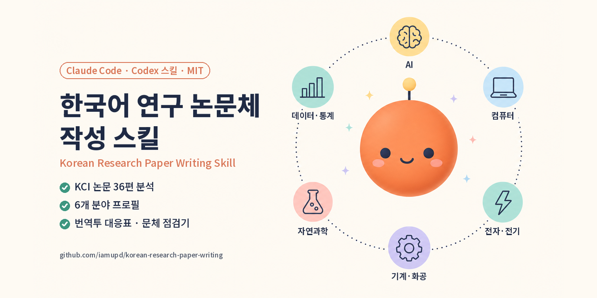

# Korean Research Paper Writing Skill for Claude Code and Codex



[](#quick-install)
[](#quick-install)
[](#reference-papers)
[](LICENSE)

English | [한국어](README.md)

A Claude Code and Codex skill for writing and revising Korean research papers in computing, engineering, and the natural sciences (experiments, measurements, simulations, and data analysis). It matches sentence length, tense, sentence linking, term glossing, and statistics reporting to 30 papers published in KCI-indexed Korean journals in 2024, grouped into six fields. It first identifies the field of the draft, then writes and checks it against that field's section structure and reference.

**Install** (Claude Code CLI):

```bash
claude plugin marketplace add iamupd/korean-research-paper-writing
claude plugin install korean-research-paper-writing@korean-research-paper-writing
```

After installing, ask as you normally would, for example "translate this English draft into a Korean paper" or "revise this AI-written introduction in Korean academic style". To use the skill without the plugin system or in Codex, see [Quick install](#quick-install).

> **This is not a tool for hiding AI use.** It was not built to evade AI detectors. It fixes sentences that lower the quality of a paper: English drafts carried over word for word, claims stronger than the evidence, and conclusions that contradict the results. If you used AI, disclose it as your venue requires.

### Why 2024 KCI papers?

[Lee (2026, arXiv:2609.07447)](https://arxiv.org/abs/2609.07447) analyzed more than 390,000 KCI abstracts and found that words LLMs favor, such as 시사한다 ("suggests"), 확인되었다 ("was confirmed"), and 구조적 ("structural"), rose sharply from late 2024. The register reference is therefore 30 papers published in 2024, submitted between March 2023 and October 8, 2024. Papers from 2025 were used only for sentence frames that report confidence intervals, significance tests, and repeated runs.

---

## Quick install

**Requirements**

- [Claude Code](https://docs.claude.com/en/docs/claude-code/setup) or [Codex](https://learn.chatgpt.com/docs/build-skills)
- *Optional:* Python 3.9 or later to run the style checker directly

**Plugin install (recommended)**

```bash
claude plugin marketplace add iamupd/korean-research-paper-writing
claude plugin install korean-research-paper-writing@korean-research-paper-writing
```

**Copy the skill folder only**

```bash
git clone https://github.com/iamupd/korean-research-paper-writing
cp -r korean-research-paper-writing/plugins/korean-research-paper-writing/skills/writing-korean-research-papers ~/.claude/skills/
```

**Use in Codex**

```bash
git clone https://github.com/iamupd/korean-research-paper-writing
mkdir -p ~/.agents/skills
cp -r korean-research-paper-writing/plugins/korean-research-paper-writing/skills/writing-korean-research-papers ~/.agents/skills/
```

Codex reads skills from `~/.agents/skills/` (all projects) or `.agents/skills/` inside a project (that project only) ([Codex skills docs](https://learn.chatgpt.com/docs/build-skills)). Call the skill by putting `$writing-korean-research-papers` before the request. In our test the skill ran when named and did not run on its own when the request did not name it.

**Check that it works:** with a Korean draft open, ask "check the style of this draft". You get the checker table and the sentences to fix.

## Features at a glance

- **Field profiles**: section structure (for example, the combined "results and discussion" chapter in chemical engineering and chemistry, or separate simulation and real-data chapters in statistics), sentence conventions, and field medians for six fields: AI, computing other than AI, electronics and electrical engineering, mechanical, chemical, materials, and civil engineering, natural sciences, and data analysis and statistics.
- **Section moves**: paragraph order, typical sentence frames, and tense for the abstract, introduction, related work, method, results, and conclusion.
- **Sentence targets**: reference ranges for sentence length, sentence linking, term glossing, result verbs, and LLM-associated words, plus rules for tense and subject. Tense follows what each sentence does (past for your own experiments and observations, present for table descriptions and system behavior), not a target ratio.
- **Translation table**: eleven English patterns, such as "Our findings:", "The practical rule is simple:", "X helps only when Y", and an aside set off by em dashes, each mapped to a Korean paper frame.
- **Statistics and experiment frames**: sentences for repeated runs, mean ± standard deviation, 95% confidence intervals, significance tests, null results, interactions, ablations, and preregistered criteria, plus a strength table that matches the verb to the evidence.
- **Style checker** (`ko_style_check.py`): scores a .tex, .md, or .txt draft on seven metrics, LLM-associated words, translation markers, statistics notation, past-tense spelling (mixed 하였다 and 했다), and em dashes (including LaTeX `---`), and compares each with the reference range. Tense ratios are not judged. With `--field`, the question-mark rate, which differed between fields, is judged against the field range, and every metric shows the field median.

Every frame cites its source paper. Frames for cases no reference paper covers (paired-seed confidence intervals, preregistered criteria, and so on) are marked as the author's proposals.

---

## Examples

The example sentences stay in Korean, since Korean register is what the skill changes.

### Translating an English draft

| # | English draft | Plain translation | With the skill | What changed |
|---|---|---|---|---|
| 1 | MRR@10 rises up to 25% (KoMS 0.612 to 0.648) and falls beyond 50% (0.603 at 75%). | MRR@10(Mean Reciprocal Rank at 10: 상위 10위 안에 처음 나타나는 정답 순위의 역수를 전체 질의에 대해 평균한 값)은 하드 네거티브 비율 25%까지 상승하였고(KoMS 0.612에서 0.648), 50%를 넘어서면 하락하였다(75%에서 0.603). | 실험 결과, 상위 10위 평균 역순위(MRR@10)는 비율 25%까지 높아져 KoMS에서 0.612에서 0.648로 상승하였으나, 50%를 넘어서면서 하락하여 75%에서는 0.603을 보였다. | Long parenthetical gloss replaced by Korean term (abbreviation) |
| 2 | Does this hold for small ones? And if not, why? We answer both questions with a controlled study. | 그렇다면 이러한 결과는 소형 모델에서도 성립하는가? 성립하지 않는다면 그 원인은 무엇인가? 본 연구는 통제된 실험을 통해 두 질문에 답한다. | 본 논문은 하드 네거티브의 효과가 소형 재순위화 모델에서도 성립하는지와, 성립하지 않는다면 그 원인이 무엇인지를 분석한다. | Two questions become one aim statement |
| 3 | The practical rule is simple: clean first, then add hard negatives. | 이로부터 도출되는 실무 원칙은 단순하다. 데이터를 먼저 정제한 다음 하드 네거티브를 추가해야 한다. | 이상의 결과는 소형 재순위화 모델을 학습할 때 거짓 음성을 먼저 제거한 뒤 하드 네거티브를 추가하여야 함을 보여 준다. | Literal discourse marker removed |
| 4 | Beyond 50% the trend reverses. At 75%, KoMS falls to 0.603, below the 0% model. | 그러나 비율이 50%를 넘어서면 이 경향은 반전된다. 75% 조건에서 KoMS 점수는 0.603으로 하락하여 0% 모델보다도 낮아진다. | 반면, 비율이 50%를 넘어서면 추세가 반전되어, 75% 조건의 KoMS MRR@10은 하드 네거티브를 쓰지 않은 0% 모델(0.612)보다 낮은 0.603을 보였다. | Present tense to past, baseline value added |
| 5 | So the ratio itself is not the problem; label noise is. | 따라서 문제는 하드 네거티브 비율 자체가 아니라 레이블 잡음(label noise)이다. | 이는 75% 조건의 성능 하락이 하드 네거티브 비율 자체보다 레이블 잡음(label noise)에 기인함을 의미하며, … | Assertion becomes a causal reading |

### Revising an AI-written draft

| # | AI-written sentence | With the skill | What changed |
|---|---|---|---|
| 6 | 리랭커 미세조정에서 하드 네거티브(hard negative: 질의와 표면적으로 유사하지만 정답이 아닌 것으로 표시된 문서)는 모델이 미세한 관련도 차이를 구분하도록 학습시키는 핵심 요소로 여겨진다. | 하드 네거티브(hard negative)란 질의와 표면적으로 유사하지만 정답이 아닌 것으로 표시된 문서를 의미하며, 리랭커 미세조정에서 모델이 미세한 관련도 차이를 구분하도록 돕는 중요한 학습 요소로 여겨진다. | Definition moved out of the parenthesis |
| 7 | 같은 75% 비율에서도 거짓 음성 제거 여부에 따라 성능이 크게 달라졌다는 점은, 높은 비율에서의 성능 하락이 하드 네거티브 비율 자체보다 그에 동반된 거짓 음성과 밀접하게 관련되어 있음을 시사한다. | 같은 75% 비율에서도 거짓 음성 제거 여부에 따라 성능이 크게 달라졌으므로, 높은 비율에서의 성능 하락은 하드 네거티브 비율 자체보다 그에 동반된 거짓 음성과 밀접하게 관련된 것으로 해석할 수 있다. | "The fact that … suggests" pattern removed |
| 8 | 사내 로그 기반 보류 세트에서도 같은 경향이 나타났다. 보류 세트에서 MRR@10이 가장 높은 조건은 25%였으며 그 값은 0.702였다. | 사내 로그 기반 보류 세트에서도 같은 경향이 나타나, MRR@10은 25% 조건에서 0.702로 가장 높았다. | English-style structure merged into one sentence |
| 9 | 첫째, 소형 리랭커에서는 하드 네거티브 비율을 높이기 전에 거짓 음성 제거가 먼저 이루어져야 한다. 비율을 높이는 것만으로는 성능이 오르지 않으며, 거짓 음성이 섞인 상태에서는 오히려 성능이 하락할 수 있다. | 첫째, 소형 리랭커에서는 하드 네거티브 비율을 높이기 전에 거짓 음성을 제거하여야 한다. 25%를 넘어 비율을 높이는 것만으로는 성능이 오르지 않았으며, 거짓 음성이 섞인 상태에서는 오히려 성능이 하락할 수 있다. | Conclusion that contradicted the results fixed |
| 10 | 이는 채굴된 하드 네거티브에 거짓 음성이 섞이는 문제를 지적한 선행 연구[5]와 부합하며, 본 결과는 그 영향이 소형 리랭커의 비율 설정에서 뚜렷한 성능 하락으로 나타남을 보여 준다. | 이는 채굴된 하드 네거티브에 거짓 음성이 섞인다는 [5]의 지적과 일치하는 결과이며, 본 실험의 0.5B 리랭커에서는 그 영향이 비율 설정에 따른 성능 하락으로 나타났다. | Overgeneralization limited to the tested model |

**Sources.** All sentences are copied from the drafts as written; "…" marks a shortened sentence.

- 1 to 5: a synthetic test study. The same English draft translated without and with the skill ([English draft](examples/synthetic-reranker/1_english_draft.md), [plain translation](examples/synthetic-reranker/2_korean_without_skill.md), [with the skill](examples/synthetic-reranker/3_korean_with_skill.md)).
- 6 to 10: three drafts an AI wrote without the skill from the same study's [research memo](examples/ai-written-revision/research_memo.md), revised with the skill. Each draft comes with the [AI draft](examples/ai-written-revision/draft_2_ai_written.md), the [revision](examples/ai-written-revision/draft_2_revised.md), and a [sentence-by-sentence change log](examples/ai-written-revision/draft_2_changes.md).

---

## Usage

### Quick start

```text
# Translate an English draft into a Korean paper
You: "draft_en.md 이 논문을 한국어로 바꿔 줘"

# Revise an AI-written draft
You: "AI로 쓴 서론이 어색해. 논문체로 고치고 무엇을 고쳤는지 알려 줘"

# Write the results section
You: "실험 결과 메모로 4장을 써 줘. 신뢰구간은 95% t 구간이야"

# Check a draft
You: "main_ko.tex 문체 점검해 줘"
```

In Claude Code, a plain request is enough to load the skill. To call it explicitly, put `/korean-research-paper-writing:writing-korean-research-papers` before the request. In Codex, put `$writing-korean-research-papers` before the request.

### Run the checker alone

```bash
python plugins/korean-research-paper-writing/skills/writing-korean-research-papers/scripts/ko_style_check.py paper.tex --field sci
```

`--field` takes one of `ai`, `cs`, `ee`, `me`, `sci`, `data`. Without it, every metric is judged against the pooled range of the 30 papers. Output for the [plain translation example](examples/synthetic-reranker/2_korean_without_skill.md) with `--field ai`:

```text
| 지표 | 원고 | 기준 범위 | 판정 | 분야 중앙값 |
|---|---|---|---|---|
| 문장 길이 중앙값(자) | 44 | 55~105 | 낮음 | 77 |
| 문두 접속어 또한/특히/그러나/반면(%) | 8.6 | 9~24 | 낮음 | 17.5 |
| 물음표 문장(/1000문장) [분야] | 57.1 | 0~35 | 높음 | 11.8 |
...
번역투 표지: '지침/규칙은 단순하다' 1, '주요 결과는 다음과 같다' 1, '예상대로' 1, '그렇다면' 의문 1, 괄호 안 콜론 뜻풀이 3
```

The checker reports in Korean: 낮음 means below the reference range, 높음 means above it, and [분야] marks a metric judged against the field range.

### Supported drafts

- LaTeX (.tex), Markdown (.md), plain text (.txt)
- Tables, figures, and captions are excluded, since they use a terse note style in Korean papers
- Translating English drafts, writing from research notes, and revising existing Korean drafts

---

## Evaluation

**Translating an English draft** (synthetic study, same draft, repeated runs)

| | Without the skill (3 runs) | With the skill (4 runs) | Reference papers (AI, 5) |
|---|---|---|---|
| Median sentence length | 44 to 52 chars | 72 to 80 chars | 68 to 79 chars |
| Translation markers (8 types) | 3 to 7 | 0 | 0 |
| LLM-associated words (per 1,000 sentences) | 54 to 57 | 0 | 0 to 59 |

**Revising AI-written drafts** (synthetic study, three drafts an AI wrote without the skill)

| | Draft 1 | Draft 2 | Draft 3 |
|---|---|---|---|
| Sentences revised | 37 | 39 | 44 |
| LLM-associated words | 3 → 0 | 3 → 0 | 1 → 0 |
| Numbers changed | 0 | 0 | 0 |

**Real conference submission** (6 pages, AI field, no numbers changed)

| | Before | After |
|---|---|---|
| Metrics out of range (`--field ai`) | 3 of 7 | 0 of 7 |
| Median sentence length | 53 chars | 69 chars |
| Sentence-initial connectives | 6.9% | 10.9% |
| Translation markers | 2 | 0 |

## Reference papers

**Register reference: 30 papers**, five per field, from KCI-indexed journals published in 2024.

| Field | Journals |
|---|---|
| AI | Journal of KIISE, KIPS Transactions, Journal of Intelligence and Information Systems (highly cited, open full text) |
| Computing other than AI | Journal of the Korea Institute of Information Security and Cryptology, Journal of KIISE, KIPS Transactions |
| Electronics and electrical | Journal of Korean Institute of Electromagnetic Engineering and Science, Transactions of the Korean Institute of Electrical Engineers, Journal of the Korean Institute of Communications and Information Sciences |
| Mechanical, chemical, materials, civil | Journal of the Korean Society for Precision Engineering, Korean Chemical Engineering Research, KSCE Journal of Civil and Environmental Engineering Research |
| Natural sciences | New Physics: Sae Mulli, Journal of the Korean Electrochemical Society, Journal of Life Science |
| Data analysis and statistics | The Korean Journal of Applied Statistics, Journal of Society of Korea Industrial and Systems Engineering, Journal of Korean Society for Quality Management |

- For the five fields other than AI, each journal was read in table-of-contents order from its first 2024 issue, and the first paper meeting the criteria was taken: an original paper reporting experiments, measurements, or data analysis, with open full text, a Korean body, and sufficient length (criteria in [corpus.md](plugins/korean-research-paper-writing/skills/writing-korean-research-papers/reference/corpus.md), section 7).
- A test across fields found clear field differences only in present-tense endings, past-tense endings, and question marks. The other metrics varied as much within a field as between fields, mostly with the type of paper (method description or measured results). Tense ratios also varied more with the type of paper than with the field (69% present tense in an electrical method paper, 25% in a measurement paper), so the checker does not judge tense by ratio.

**Statistics and experiment frames: 6 papers.** Chosen by statistics-reporting density from the full text of 149 AI papers published in 2024 and 2025 in a flagship journal of the AI field.

The 11 AI reference papers (5 register, 6 statistics) also contain flaws, such as redundant wording, "significantly" without a test, and undefined ±. These are collected separately in [phrasebank.md](plugins/korean-research-paper-writing/skills/writing-korean-research-papers/reference/phrasebank.md) so they are not imitated.

---

## Known limitations

- Each field has five reference papers. Humanities (footnote citations, hanja glosses, readings of primary texts), education research, and clinical medicine were not measured, so the skill's reference does not apply to them.
- The reference ranges are observations, not rules. A sentence outside a range is not necessarily wrong. Because each range spans the minimum and maximum of the 30 papers, a value inside the range but far from the field median is worth a second look.
- Ratio metrics are noisy for partial drafts under 60 sentences.
- The skill covers register and the conventional move structure of Korean papers. It does not cover argument design, such as which contribution to claim or which experiments support it.
- Revision of human-written Korean drafts has not been tested separately.
- Codex was tested once. The skill ran when named; running on its own without the name, and running the style checker in Codex, were not confirmed.

## License

MIT. Sentences quoted in the `reference/` folder remain the copyright of their authors and publishers and are quoted with attribution for research and criticism. The MIT license does not cover them, and any quotation will be removed at the copyright holder's request.

## Author

**Min-Young Yu**: author and maintainer

## Changelog

### v1.0.0 (2026-10-22): first release

Field profiles for six fields, section moves, sentence targets, the translation table, statistics and experiment frames, and the style checker with field ranges (`ko_style_check.py --field`). Reference: 30 research papers and 6 statistics papers from KCI-indexed journals. The same skill folder also works in Codex.
